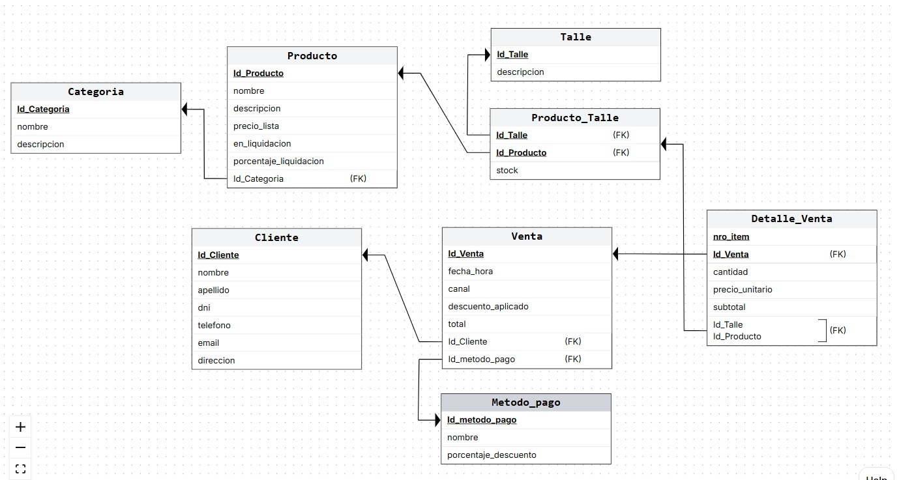

# Intensa Jeans: base de datos para una tienda de indumentaria

Proyecto de la materia **Bases de Datos I** (UNNE) del **Grupo 21**. Diseño e implementación de una base de datos relacional para **Intensa Jeans**, una tienda especializada en jeans y accesorios que vende en el local (mostrador) y online.

El sistema gestiona el catálogo de productos con stock **por talle**, el registro de clientes, las ventas por ambos canales y el cálculo de precios con liquidaciones y descuentos según el método de pago.

---

## Contenido

- [Caso de estudio](#caso-de-estudio)
- [Modelo de datos](#modelo-de-datos)
- [Estructura del repositorio](#estructura-del-repositorio)
- [Cómo ejecutar](#cómo-ejecutar)
- [Consultas (Etapa IV)](#consultas-etapa-iv)
- [Etapas del proyecto](#etapas-del-proyecto)
- [Reglas de negocio](#reglas-de-negocio)

---

## Caso de estudio

La tienda necesita centralizar su operatoria diaria:

- **Catálogo:** productos organizados por categoría, variante y talle, con stock propio por talle. Los accesorios usan un talle único genérico.
- **Clientes:** toda venta queda asociada a un cliente registrado, sin importar el canal.
- **Ventas:** se registra el precio unitario histórico de cada ítem, de modo que los cambios de precio en el catálogo no afectan las ventas ya realizadas.
- **Precios:** precio de lista, descuento por liquidación y descuento adicional según el método de pago (efectivo y transferencia sí, tarjeta no).

**Fuera del alcance:** proveedores y compras de mercadería, logística de envíos, facturación electrónica e integración con pasarelas de pago.

---

## Modelo de datos

El esquema está normalizado hasta la **Tercera Forma Normal (3FN)**.



| Tabla | Descripción |
| :--- | :--- |
| `Categoria` | Agrupa los productos del catálogo. |
| `Producto` | Variante de producto con precio de lista y datos de liquidación. |
| `Talle` | Catálogo de talles (numéricos, letras y `Único`). |
| `Producto_Talle` | Stock de cada producto por talle. PK compuesta `(Id_Producto, Id_Talle)`. |
| `Cliente` | Datos del comprador. DNI y email únicos. |
| `Metodo_pago` | Medio de pago con su porcentaje de descuento. |
| `Venta` | Encabezado de la venta: fecha, canal, cliente, método de pago, descuento y total. |
| `Detalle_Venta` | Renglones de la venta con precio unitario histórico. PK compuesta `(Id_Venta, nro_item)`. |

**Decisiones de diseño destacadas:**

- `Detalle_Venta` referencia a `Producto_Talle` con una FK compuesta, para saber exactamente qué talle se vendió y de qué stock se descuenta.
- `precio_unitario`, `subtotal` y `total` se almacenan como dato histórico (redundancia controlada) para garantizar la trazabilidad de los precios.
- Las FK usan `ON DELETE NO ACTION` en general (no se pueden borrar categorías, clientes o productos con registros asociados) y `CASCADE` entre `Venta` y `Detalle_Venta`.

---

## Estructura del repositorio

```
docs/
├── etapa-01/                      # Análisis del caso
│   ├── descripcion-caso.md
│   ├── alcance.md
│   ├── reglas-negocio.md
│   └── decisiones-diseno.md
├── etapa-02/                      # Modelado
│   ├── der/DER.jpeg
│   ├── modelo-relacional.md
│   ├── normalizacion.md
│   └── decisiones_de_disenio.md
├── etapa-03/                      # Implementación
│   ├── ecommerce.sql              # DDL: crea la base y las tablas
│   ├── tienda_ropa_dml.sql        # DML: datos de prueba
│   ├── implementacion.md
│   ├── restricciones-integridad.md
│   └── pruebas-validacion.md
└── etapa-04/                      # Consultas y casos de uso
    ├── casos-uso.md
    ├── comprobante_venta.sql      # CU-01: comprobante de venta
    ├── comprobante-venta.md
    ├── reporte_agregado.sql       # CU-02: ventas por categoría
    ├── reporte-agregado.md
    ├── consulta_avanzada.sql      # CU-03: clientes de mayor valor
    └── consulta-avanzada.md
```

---

## Cómo ejecutar

**Requisitos:** Microsoft SQL Server y SQL Server Management Studio o Azure Data Studio.

1. Ejecutar [`docs/etapa-03/ecommerce.sql`](docs/etapa-03/ecommerce.sql). Crea la base `tienda_ropa` (si no existe) y las 8 tablas en orden de dependencia.
2. Ejecutar [`docs/etapa-03/tienda_ropa_dml.sql`](docs/etapa-03/tienda_ropa_dml.sql). Carga los datos de prueba.
3. Opcional: correr las consultas de [`pruebas-validacion.md`](docs/etapa-03/pruebas-validacion.md) para verificar la carga, la integridad y las restricciones.
4. Ejecutar las consultas de la Etapa IV (ver [Consultas](#consultas-etapa-iv)). Cada una se corre por separado, después de cargar los datos de prueba.

> Los scripts no son re-ejecutables sobre una base ya creada o poblada. Para volver a correrlos, eliminar antes las tablas o la base `tienda_ropa`.

### Datos de prueba

| Tabla | Registros |
| :--- | :---: |
| `Categoria` | 8 |
| `Talle` | 10 |
| `Metodo_pago` | 8 |
| `Cliente` | 10 |
| `Producto` | 10 |
| `Producto_Talle` | 24 |
| `Venta` | 10 |
| `Detalle_Venta` | 17 |

---

## Consultas (Etapa IV)

Las necesidades de información de la etapa se modelan como casos de uso en [`casos-uso.md`](docs/etapa-04/casos-uso.md). Cada consulta tiene su script y un documento con la estrategia SQL, el resultado esperado y cómo probarla.

| Caso de uso | Necesidad de información | Script | Documentación |
| :--- | :--- | :--- | :--- |
| **CU-01** | Comprobante de venta: encabezado y detalle, con subtotal por renglón y total acumulado. | [`comprobante_venta.sql`](docs/etapa-04/comprobante_venta.sql) | [`comprobante-venta.md`](docs/etapa-04/comprobante-venta.md) |
| **CU-02** | Reporte agregado: total de ventas por categoría de producto en un rango de fechas (`GROUP BY`, `SUM`, `COUNT`, `ROLLUP`). | [`reporte_agregado.sql`](docs/etapa-04/reporte_agregado.sql) | [`reporte-agregado.md`](docs/etapa-04/reporte-agregado.md) |
| **CU-03** | Consulta avanzada: clientes de mayor valor, combinando al menos 3 tablas con `JOIN` y filtros con `HAVING` o subconsultas. | [`consulta_avanzada.sql`](docs/etapa-04/consulta_avanzada.sql) | [`consulta-avanzada.md`](docs/etapa-04/consulta-avanzada.md) |

> El modelo no tiene la entidad `Vendedor`, por eso el reporte agregado se agrupa por categoría de producto.

---

## Etapas del proyecto

| Etapa | Contenido | Estado |
| :--- | :--- | :---: |
| **I** | Descripción del caso, alcance, reglas de negocio y decisiones de diseño | ✅ |
| **II** | DER, modelo relacional y normalización hasta 3FN | ✅ |
| **III** | Scripts DDL y DML, restricciones de integridad y pruebas de validación | ✅ |
| **IV** | Casos de uso, comprobante de venta, reporte agregado por categoría y consulta de negocio avanzada | ⏳ |
| **V** | Transacciones y triggers: validación y descuento automático de stock | ⏳ |

---

## Reglas de negocio

| Código | Regla |
| :--- | :--- |
| **RN.01** | Cada prenda es una variante que se gestiona por talle, con stock independiente. Los accesorios usan un talle único. |
| **RN.02** | El stock se descuenta al confirmar la venta. No se puede vender más que el stock disponible del talle. |
| **RN.03** | Todo producto pertenece a una única categoría. |
| **RN.04** | Toda venta se asocia a un cliente registrado. |
| **RN.05** | Cada producto tiene un precio de lista. |
| **RN.06** | Los productos en liquidación tienen un descuento sobre el precio de lista. |
| **RN.07** | Pagando en efectivo o transferencia se aplica un descuento adicional sobre el precio vigente. |
| **RN.08** | El precio unitario se registra en el detalle al momento de la venta. |
| **RN.09** | Métodos de pago admitidos: efectivo, transferencia y tarjeta. |

El detalle completo está en [`docs/etapa-01/reglas-negocio.md`](docs/etapa-01/reglas-negocio.md).
